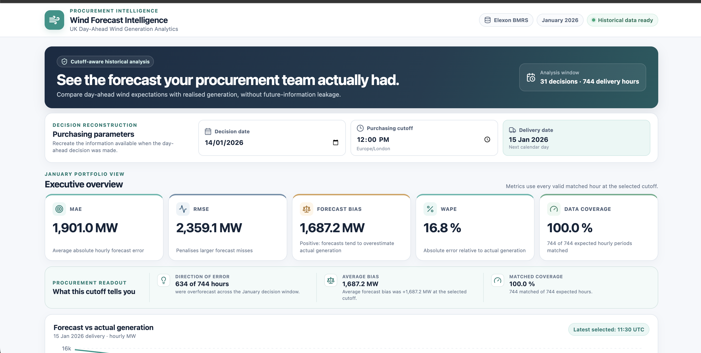

# Wind Forecast Intelligence

**Cutoff-aware UK day-ahead wind generation forecasting and accuracy analytics**

Wind Forecast Intelligence is a full-stack decision-support dashboard that helps electricity procurement teams evaluate the wind generation forecasts available at the time of a historical purchasing decision.

Instead of comparing actual generation with a forecast published later, the application reconstructs what was known at the chosen decision cutoff, helping prevent look-ahead bias in forecast evaluation.

Built with **React, Flask, Python, Recharts, and historical Elexon BMRS data**.

## The Problem

Electricity procurement decisions depend on the expected availability of wind generation. When actual wind output differs from forecasts, procurement teams may face greater uncertainty when planning purchases.

Evaluating forecast accuracy fairly requires using only forecasts published before the purchasing decision—not revised forecasts published afterward.

This application provides a transparent, cutoff-aware historical evaluation workflow.

## Key Features

- **Configurable decision cutoff:** Select a January 2026 purchasing date and Europe/London cutoff time.
- **Historical forecast reconstruction:** Select the latest eligible published forecast for each next-day delivery hour.
- **Forecast vs actual visualization:** Compare predicted wind generation with actual generation using interactive charts.
- **Accuracy analytics:** Calculate MAE, RMSE, signed bias, WAPE, and data coverage.
- **Daily performance analysis:** Explore daily errors and overforecast/underforecast patterns.
- **Hourly auditability:** Inspect forecast values, actual output, errors, and forecast publication timestamps.
- **Transparent data handling:** Preserve historical forecast revisions and report missing or conflicting observations.
- **Responsive dashboard:** Support desktop, tablet, and mobile layouts.

## Dashboard Preview

Add a screenshot of the working dashboard here:



## January 2026 Results

The following results use a 12:00 Europe/London purchasing cutoff across the January 2026 decision period.

| Metric | Value |
|---|---:|
| Decision dates | 31 |
| Matched hourly observations | 744 / 744 |
| Mean Absolute Error (MAE) | 1,901.001 MW |
| Root Mean Square Error (RMSE) | 2,359.126 MW |
| Mean Forecast Bias | +1,687.223 MW |
| Weighted Absolute Percentage Error (WAPE) | 16.848% |
| Overforecast periods | 634 |
| Underforecast periods | 110 |
| Matched data coverage | 100% |

**Key observation:** At the selected cutoff, historical forecasts more frequently overestimated than underestimated wind generation.

These results represent forecast accuracy, not estimated financial losses or realized electricity procurement costs.

## Technology Stack

| Layer | Technologies |
|---|---|
| Frontend | React, Vite, JavaScript, Recharts |
| Backend | Python, Flask, Gunicorn |
| Data source | Elexon BMRS API |
| Storage | Version-preserving historical JSON |
| Testing | pytest |
| Containerization | Docker, Docker Compose |
| Deployment | Render backend, Vercel frontend |

## Architecture

```text
Elexon BMRS APIs
       |
       v
Python ingestion and validation
       |
       v
Historical JSON datasets
       |
       v
Flask analysis services
       |
       v
REST APIs
       |
       v
React dashboard
```

The application uses preprocessed historical data for dashboard requests rather than fetching data from Elexon on every request.

### Data Sources

**FUELHH:** Actual wind generation, provided at half-hourly intervals.

**WINDFOR:** Historical wind generation forecasts, including publication and target timestamps.

The analysis covers purchasing decisions from January 1–31, 2026, with next-day deliveries through February 1, 2026.

## Forecast Selection Methodology

For each selected decision date and cutoff:

1. Determine the following Europe/London calendar date as the delivery date.
2. Identify forecast records targeting that delivery date.
3. Exclude forecasts published after the purchasing cutoff.
4. Select the latest eligible forecast publication independently for each hourly target.
5. Align selected hourly forecasts with available hourly actual observations.
6. Calculate accuracy metrics using valid matched observations only.

Hourly actual generation is derived from the arithmetic mean of two complete, aligned half-hourly FUELHH observations. This comparison assumes compatible hourly interval semantics for WINDFOR; that interpretation remains a documented limitation.

No missing observations are replaced with fabricated or interpolated values.

## Getting Started

### Prerequisites

- Python 3.11+
- Node.js and npm
- Git

### Backend

From the project root:

```bash
python3 -m venv .venv
source .venv/bin/activate
python -m pip install -r requirements-dev.txt
python backend/run.py
```

The development API runs at:

`http://127.0.0.1:5000`

### Frontend

Open a second terminal:

```bash
cd frontend
npm install
cp .env.example .env.local
npm run dev
```

Open:

`http://127.0.0.1:5173`

Configure `VITE_API_BASE_URL` in `frontend/.env.local` if the backend runs at a different address.

### Running Tests

```bash
python -m pytest backend/tests -q
```

### Historical Data Ingestion

To regenerate the January 2026 historical dataset:

```bash
python backend/scripts/ingest_data.py \
  --decision-start 2026-01-01 \
  --decision-end 2026-01-31 \
  --decision-cutoff 12:00
```

The ingestion pipeline preserves source records, handles transient API failures, detects conflicts, and generates validation reports.

## REST API

| Endpoint | Purpose |
|---|---|
| `GET /api/health` | Service and historical-data availability |
| `GET /api/summary?cutoff=12:00` | January aggregate metrics and daily accuracy |
| `GET /api/forecast?decision_date=2026-01-14&cutoff=12:00` | Selected-day forecast, actual generation, errors, and coverage |

All purchasing cutoff times are interpreted in `Europe/London`.

## Docker and Deployment

The project includes Docker configuration for containerized execution.

For local container testing:

```bash
docker compose build
docker compose up -d
```

The planned public deployment uses Render for the Flask API and Vercel for the React frontend. Deployment is not yet complete.

Production configuration requires the historical processed JSON files to be packaged with the backend, an appropriately configured `VITE_API_BASE_URL`, and a restricted `CORS_ALLOWED_ORIGINS` allowlist.

## Design Decisions

- **No look-ahead bias:** Only forecasts available by the selected decision time are eligible.
- **Historical reproducibility:** Preserve forecast publication history rather than replacing older forecasts.
- **Simple data architecture:** Use preprocessed JSON instead of introducing an unnecessary database for a fixed historical analysis.
- **Reliable missing-data handling:** Exclude incomplete matches and report coverage.
- **Separation of concerns:** Keep ingestion, forecast selection, metrics calculation, API delivery, and UI presentation independent.

For further details, see [Architecture](docs/ARCHITECTURE.md), [Data Exploration](docs/DATA_EXPLORATION.md), and [Assumptions](docs/ASSUMPTIONS.md).

## Limitations

- The analysis is restricted to January 2026 purchasing decisions.
- WINDFOR hourly target interpretation remains a documented assumption.
- The latest available FUELHH publication is used as a proxy for the actual generation revision policy.
- Forecast errors do not directly imply financial loss without purchasing volume and market price information.
- Accuracy coverage may vary when the decision cutoff changes.

## AI-Assisted Development (OpenAI Codex)

**AI tools used:** OpenAI Codex (coding assistant), with ChatGPT used to help plan implementation steps, clarify the energy-domain requirements, and review documentation and presentation explanations.

I used **OpenAI Codex** as a development assistant throughout the project. Work was organized into small, reviewable phases rather than asking the tool to generate the entire application in one step:

- **Project setup and design:** Helped scaffold the React/Flask project structure and draft initial architecture, assumptions, and data-exploration documentation.
- **Elexon data exploration and ingestion:** Assisted with API probing, bounded data fetching, retry/error handling, normalization, historical record storage, and validation reporting.
- **Forecast analysis and backend:** Assisted with implementing cutoff-aware forecast selection, hourly forecast/actual alignment, accuracy metrics, Flask services, and REST API routes.
- **Dashboard development:** Assisted with React components, charts, date/cutoff controls, responsive styling, and loading/error states.
- **Testing and deployment preparation:** Assisted with pytest test cases, edge-case checks, Docker configuration, and Render/Vercel deployment files.
- **Documentation:** Helped draft and refine the README and technical documentation.

**My role and verification:** I defined the business requirements and decision-cutoff rules, directed the implementation through iterative prompts, reviewed the generated code and UI, ran the application locally, checked the Elexon responses, and validated forecast-selection behavior against historical examples. I also reviewed the assumptions and limitations rather than treating AI-generated outputs as automatically correct.

For example, I checked that a **14 January 2026, 12:00 Europe/London** purchasing cutoff selects forecasts published before that cutoff for **15 January** delivery, and that later publications are excluded. I also validated the full-month ingestion counts and inspected the dashboard using the processed dataset.

AI assistance was used to accelerate implementation; the project methodology, results, and documented limitations remain subject to the validation described in this repository. Any tests or deployment steps not yet run are not represented as completed.

## Data Attribution

Historical forecast and generation data is sourced from [Elexon BMRS](https://bmrs.elexon.co.uk/).

This is an independent technical demonstration and is not affiliated with Elexon.